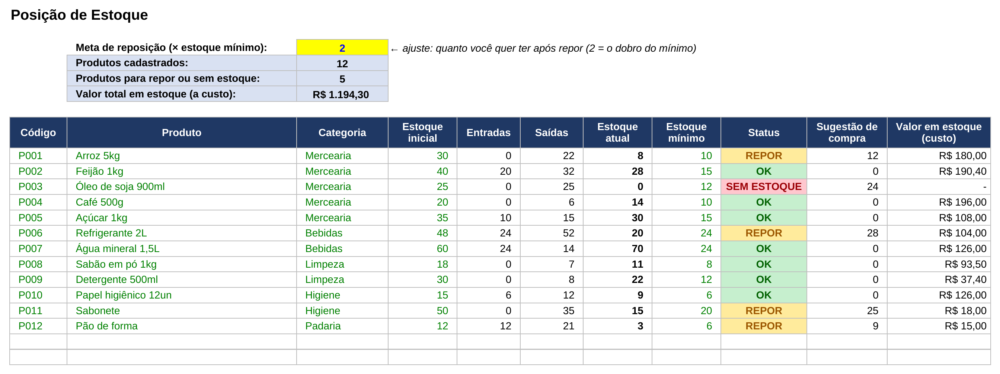
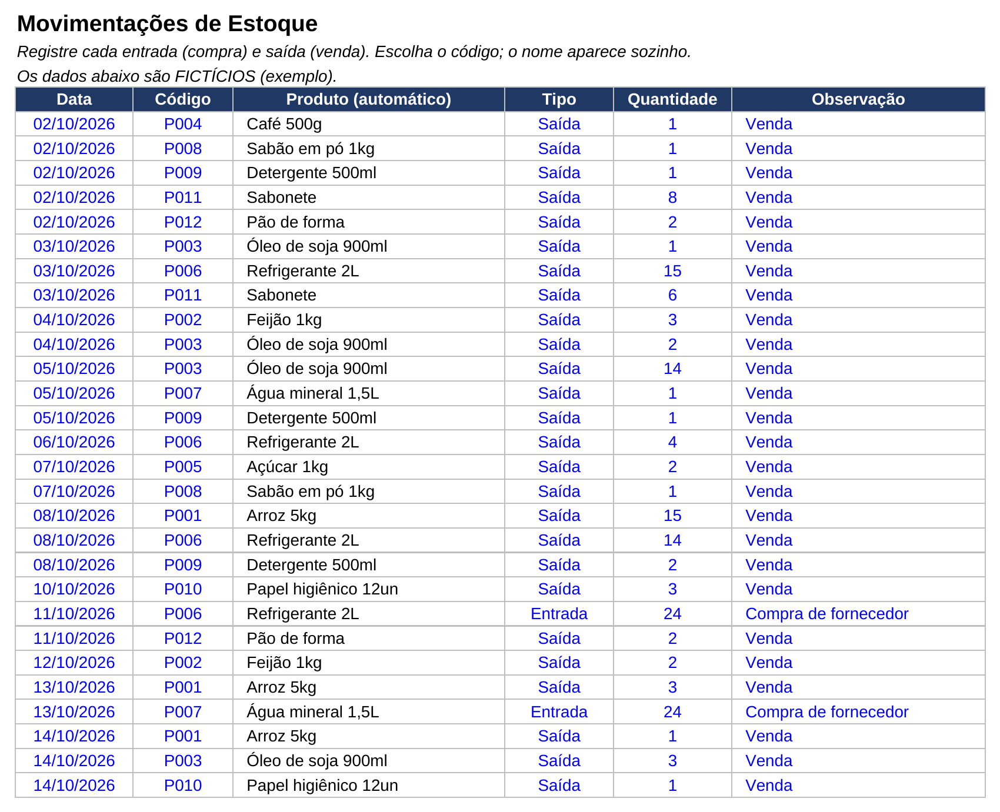
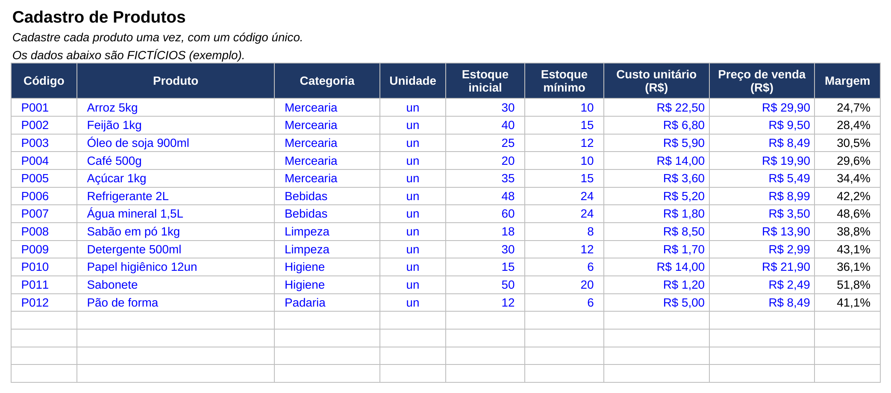

# Controle de Estoque com Alerta de Reposição

Planilha em Excel para pequenos comércios acompanharem o estoque, saberem **o que está acabando** e **quanto comprar**.

> Os produtos, quantidades e preços de exemplo são fictícios.

## O problema

Em muitos pequenos negócios o estoque é controlado de cabeça ou em caderno. O resultado: produto que falta na hora da venda, compra em excesso e dinheiro parado na prateleira.

## A solução

Uma planilha em que você cadastra os produtos uma vez e registra só as entradas e saídas. A posição do estoque e os alertas aparecem sozinhos.

## O que ela faz

- Cadastro de produtos com código, categoria, estoque inicial, estoque mínimo, custo e preço
- **Margem de lucro** calculada por produto
- Registro de **entradas** (compras) e **saídas** (vendas ou uso)
- Código escolhido em lista suspensa, com o **nome do produto preenchido automaticamente**
- **Posição de estoque** atualizada em tempo real
- **Alerta por cores**: verde (OK), amarelo (repor) e vermelho (sem estoque)
- **Sugestão de compra**: quantas unidades comprar para chegar à meta de reposição, que é configurável
- **Valor total em estoque** (a custo)
- Indicadores no topo: produtos cadastrados, produtos para repor e valor em estoque

## Prints

### Posição de estoque e alertas

### Movimentações

### Cadastro de produtos

## Como usar

1. Na aba **Produtos**, cadastre cada item uma vez, com um código único.
2. Na aba **Movimentações**, registre cada entrada e cada saída.
3. Na aba **Estoque**, veja a situação de cada produto e o que precisa comprar.
4. Ajuste a **meta de reposição** na célula amarela (padrão: 2 × o estoque mínimo).
5. Para usar com seus dados, apague o exemplo nas colunas azuis de Produtos e Movimentações (a partir da linha 5).

## Como funciona por dentro

- **Estoque atual** = estoque inicial + entradas - saídas
- **Status**: SEM ESTOQUE se for 0 ou menos; REPOR se for igual ou menor que o mínimo; OK nos demais casos
- **Sugestão de compra** = (meta × estoque mínimo) - estoque atual, arredondado para cima
- Entradas e saídas são somadas com `SUMIFS`, e o nome do produto vem de `INDEX` + `MATCH`
- Tudo é fórmula: nada precisa ser recalculado manualmente
- Comporta até 200 produtos e 1.000 movimentações (dá para ampliar sob pedido)

## Arquivos

- `controle_estoque.xlsx`: a planilha
- `prints/`: imagens das telas

## Adaptações possíveis

Posso adaptar para o seu tipo de negócio: validade de produtos, vários fornecedores, estoque por local, relatório de mais vendidos, entre outras.

Contato: levileme2006@hotmail.com ou [LinkedIn](https://www.linkedin.com/in/levi-leme-1b5a08309)
