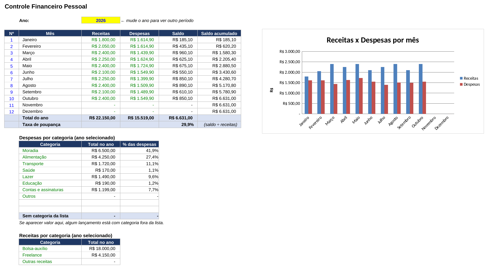
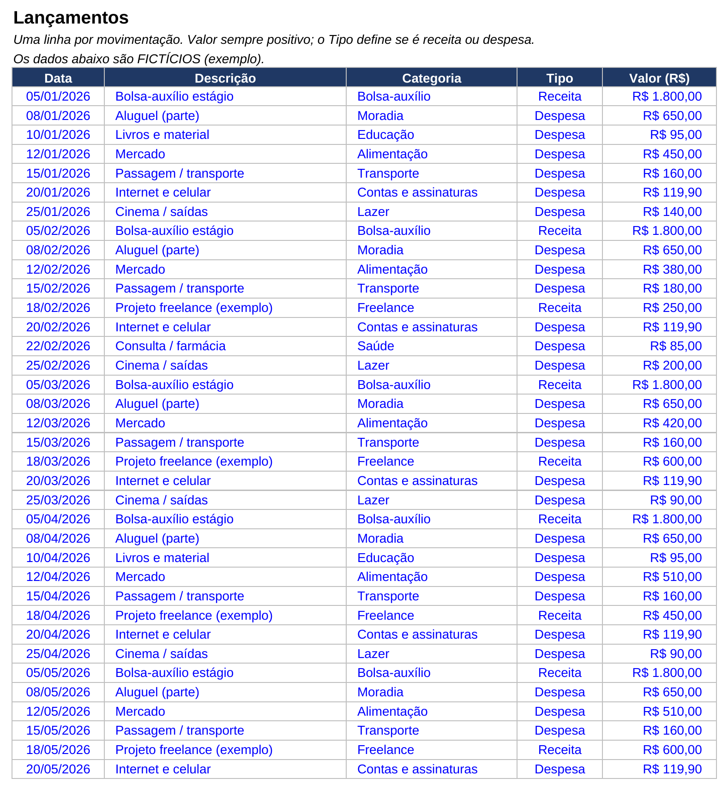

# Controle Financeiro Pessoal

Planilha em Excel para organizar receitas e despesas, ver o saldo de cada mês e entender para onde o dinheiro está indo, **sem precisar mexer em fórmulas**.

> Os dados de exemplo são fictícios.

## O problema

Muita gente (e muito autônomo) anota gastos em vários lugares, ou só olha o extrato no fim do mês. Fica difícil saber quanto sobrou, o que pesa mais no orçamento e se a conta está fechando.

## A solução

Uma planilha em que você só digita cada movimentação, e todo o resto é calculado automaticamente.

## O que ela faz

- Registro de receitas e despesas com data, descrição, categoria e valor
- **Resumo mensal** de receitas, despesas, saldo e saldo acumulado
- **Taxa de poupança** do ano
- **Gráfico** de receitas x despesas por mês
- Total por **categoria** de despesa, com a porcentagem de cada uma
- Total por categoria de receita
- Troca de ano em uma única célula
- Listas suspensas e validação de dados para evitar erros de digitação
- Categorias editáveis

## Prints

### Resumo

### Lançamentos

## Como usar

1. Abra a aba **Lançamentos** e preencha uma linha por movimentação (valor sempre positivo; o **Tipo** define se é receita ou despesa).
2. Abra a aba **Resumo**: os totais, o gráfico e as categorias já estão atualizados.
3. Para outro ano, mude a célula amarela do **Ano**.
4. Para criar ou renomear categorias, use a aba **Listas**.
5. Para usar com seus dados, apague o exemplo nas colunas A a E da aba Lançamentos (a partir da linha 5).

## Como funciona por dentro

- Os totais usam `SUMIFS`, que soma por tipo, categoria e intervalo de datas.
- O saldo acumulado é uma soma corrida mês a mês.
- Nenhum resultado é digitado à mão: tudo é fórmula, então a planilha se recalcula quando você muda um lançamento.
- Comporta até 500 lançamentos (dá para ampliar sob pedido).

## Arquivos

- `controle_financeiro.xlsx`: a planilha
- `prints/`: imagens das telas

## Adaptações possíveis

Posso adaptar para autônomos, pequenas lojas ou casais: categorias próprias, metas por categoria, controle de contas a pagar, entre outras.

Contato: levileme2006@hotmail.com ou [LinkedIn](https://www.linkedin.com/in/levi-leme-1b5a08309)
